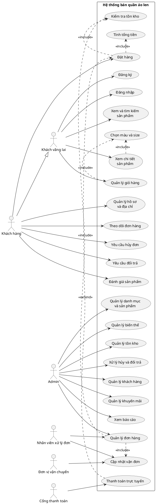
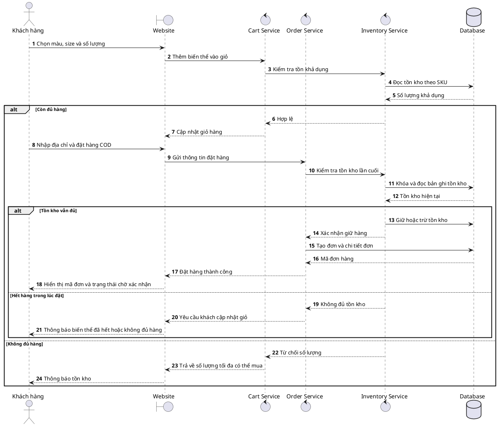
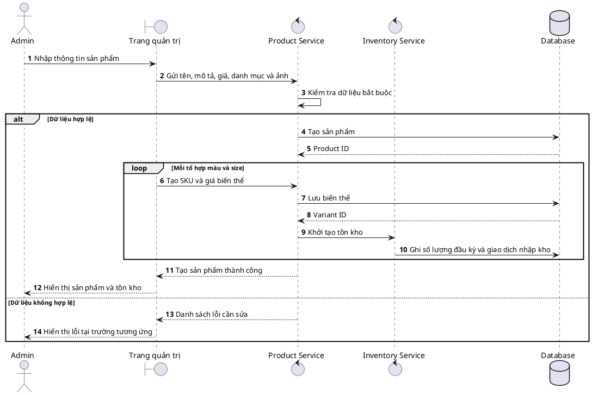
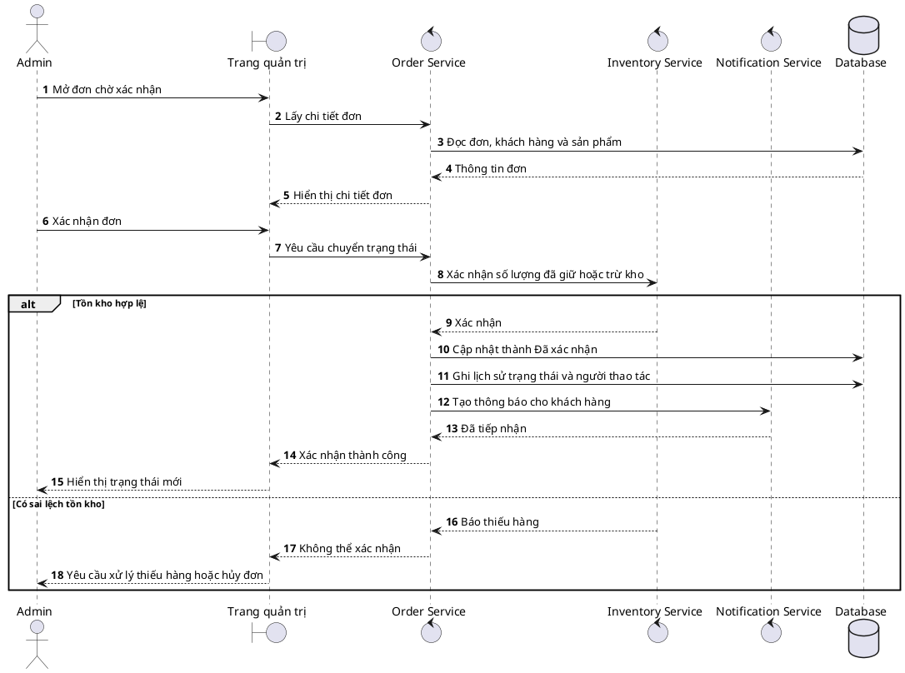
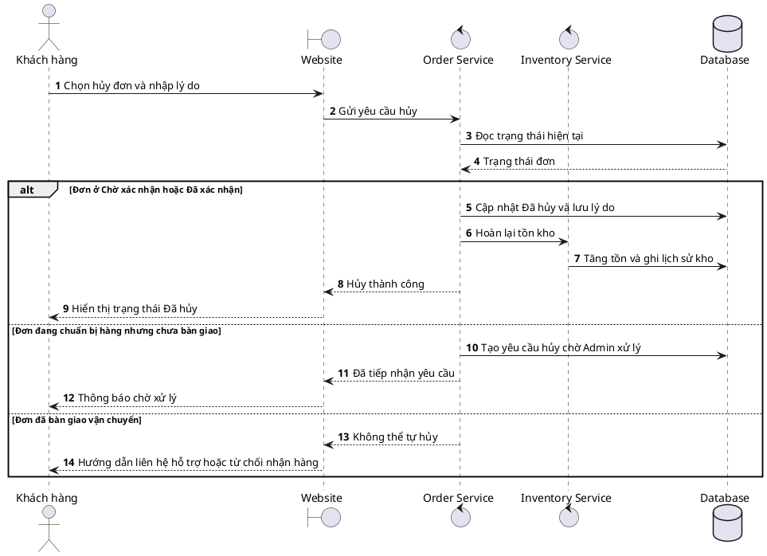
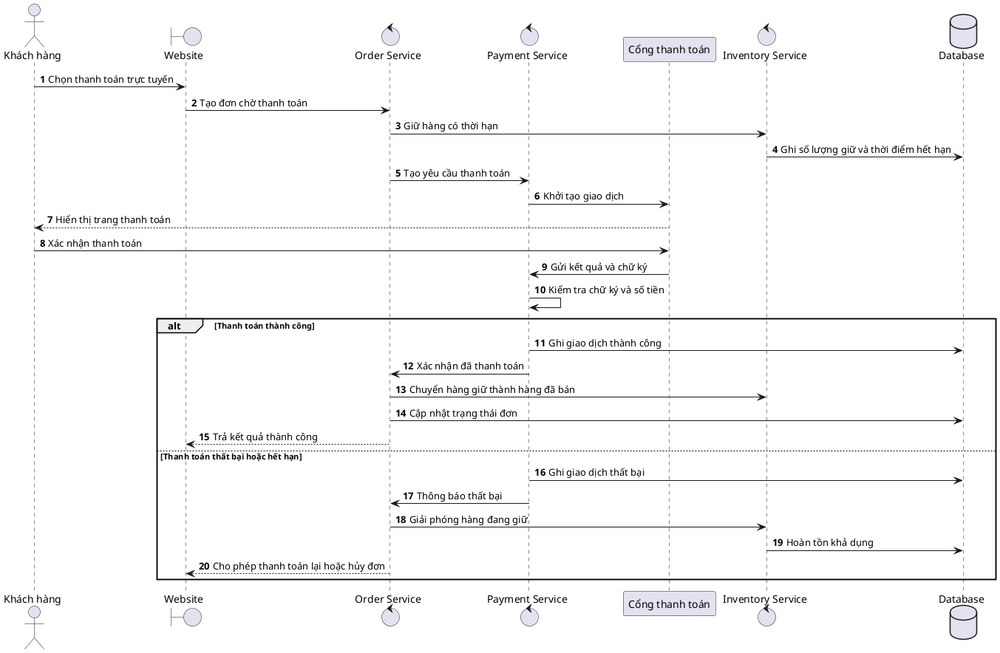
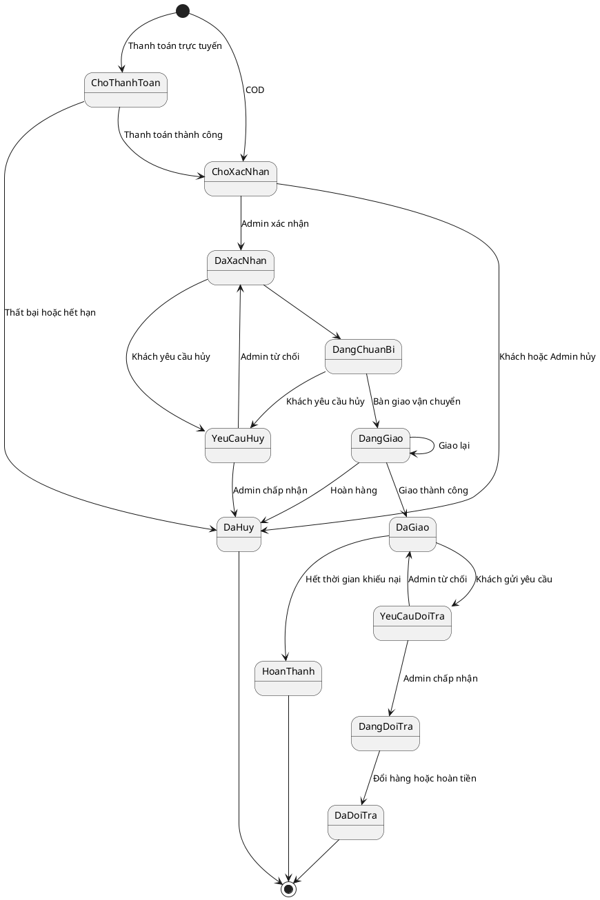

# Kế hoạch và nghiệp vụ hệ thống bán quần áo len

## 1. Mục đích tài liệu

Tài liệu mô tả phạm vi, tác nhân, nghiệp vụ, Use Case, Sequence Diagram và kế hoạch triển khai hệ thống bán quần áo len. Hệ thống có hai nhóm người dùng chính:

- **Khách hàng:** xem mẫu len, chọn màu và kích thước, đặt hàng, thanh toán và theo dõi đơn.
- **Admin:** quản lý sản phẩm, biến thể, tồn kho, khách hàng, đơn hàng, khuyến mãi và báo cáo.

Phiên bản đầu tiên ưu tiên website tương thích điện thoại và thanh toán khi nhận hàng. Thanh toán trực tuyến, kết nối vận chuyển và đồng bộ sàn thương mại điện tử được triển khai ở giai đoạn sau.

## 2. Phạm vi hệ thống

### 2.1 Phạm vi phiên bản MVP

- Đăng ký, đăng nhập và quản lý tài khoản khách hàng.
- Xem danh mục, tìm kiếm và lọc sản phẩm.
- Xem chi tiết mẫu len, ảnh, giá, màu, size và tồn kho.
- Thêm, sửa và xóa sản phẩm trong giỏ hàng.
- Đặt hàng theo hình thức COD.
- Tra cứu và theo dõi trạng thái đơn hàng.
- Khách hàng yêu cầu hủy đơn khi đơn chưa được giao cho đơn vị vận chuyển.
- Admin quản lý danh mục, sản phẩm, biến thể và tồn kho.
- Admin tiếp nhận và xử lý đơn hàng.
- Admin quản lý thông tin khách hàng.
- Admin xem báo cáo doanh thu và cảnh báo tồn kho cơ bản.

### 2.2 Phạm vi mở rộng

- Thanh toán VNPay, MoMo hoặc ZaloPay.
- Tích hợp GHN, GHTK hoặc Viettel Post.
- Mã giảm giá và chương trình khuyến mãi nâng cao.
- Đánh giá có hình ảnh hoặc video.
- Đổi trả và hoàn tiền trực tuyến.
- Điểm thưởng và hạng thành viên.
- Đồng bộ sản phẩm, tồn kho và đơn hàng với Shopee.
- Thông báo tự động qua email, SMS hoặc Zalo.

## 3. Tác nhân và trách nhiệm

| Tác nhân | Trách nhiệm |
|---|---|
| Khách vãng lai | Xem, tìm kiếm sản phẩm, quản lý giỏ hàng và có thể đặt hàng không cần tài khoản |
| Khách hàng | Quản lý hồ sơ, địa chỉ, đặt hàng, theo dõi đơn, yêu cầu hủy hoặc đổi trả, đánh giá sản phẩm |
| Admin | Quản lý toàn bộ sản phẩm, kho, đơn hàng, khách hàng, khuyến mãi và báo cáo |
| Nhân viên xử lý đơn | Xác nhận đơn, chuẩn bị hàng, nhập mã vận đơn và cập nhật trạng thái trong phạm vi được cấp quyền |
| Cổng thanh toán | Tiếp nhận và phản hồi kết quả thanh toán trực tuyến trong giai đoạn mở rộng |
| Đơn vị vận chuyển | Tiếp nhận vận đơn và trả về trạng thái giao hàng trong giai đoạn mở rộng |

## 4. Danh sách nghiệp vụ theo Use Case

### 4.1 Nhóm tài khoản và phân quyền

| Mã | Nghiệp vụ | Tác nhân | Kết quả mong đợi | Ưu tiên |
|---|---|---|---|---|
| UC-A01 | Đăng ký tài khoản | Khách vãng lai | Tạo tài khoản khách hàng hợp lệ | MVP |
| UC-A02 | Đăng nhập | Khách hàng, Admin | Tạo phiên đăng nhập theo đúng vai trò | MVP |
| UC-A03 | Đăng xuất | Khách hàng, Admin | Kết thúc phiên đăng nhập | MVP |
| UC-A04 | Khôi phục mật khẩu | Khách hàng, Admin | Cấp lại quyền truy cập qua kênh xác minh | Mở rộng |
| UC-A05 | Cập nhật hồ sơ | Khách hàng | Lưu họ tên, số điện thoại và thông tin cá nhân | MVP |
| UC-A06 | Quản lý địa chỉ | Khách hàng | Thêm, sửa, xóa và chọn địa chỉ mặc định | MVP |
| UC-A07 | Quản lý tài khoản nhân viên | Admin | Tạo tài khoản và gán quyền nghiệp vụ | Mở rộng |

### 4.2 Nhóm sản phẩm và tra cứu

| Mã | Nghiệp vụ | Tác nhân | Kết quả mong đợi | Ưu tiên |
|---|---|---|---|---|
| UC-P01 | Xem danh sách sản phẩm | Khách | Hiển thị các sản phẩm đang bán | MVP |
| UC-P02 | Xem chi tiết sản phẩm | Khách | Hiển thị ảnh, mô tả, chất liệu, giá, màu, size và tồn kho | MVP |
| UC-P03 | Tìm kiếm sản phẩm | Khách | Trả về sản phẩm phù hợp từ khóa | MVP |
| UC-P04 | Lọc và sắp xếp | Khách | Lọc theo danh mục, màu, size, giá và tình trạng hàng | MVP |
| UC-P05 | Quản lý danh mục | Admin | Tạo, sửa, ẩn và sắp xếp danh mục | MVP |
| UC-P06 | Quản lý sản phẩm | Admin | Tạo, sửa, ẩn hoặc ngừng kinh doanh sản phẩm | MVP |
| UC-P07 | Quản lý biến thể | Admin | Quản lý SKU theo tổ hợp màu và size | MVP |
| UC-P08 | Quản lý hình ảnh | Admin | Thêm ảnh đại diện và bộ ảnh sản phẩm | MVP |
| UC-P09 | Quản lý bảng size | Admin | Gắn hướng dẫn chọn size vào sản phẩm | MVP |

### 4.3 Nhóm giỏ hàng và đặt hàng

| Mã | Nghiệp vụ | Tác nhân | Kết quả mong đợi | Ưu tiên |
|---|---|---|---|---|
| UC-C01 | Thêm vào giỏ hàng | Khách | Lưu đúng sản phẩm, màu, size và số lượng | MVP |
| UC-C02 | Cập nhật giỏ hàng | Khách | Thay đổi số lượng trong giới hạn tồn kho | MVP |
| UC-C03 | Xóa khỏi giỏ hàng | Khách | Loại sản phẩm không còn nhu cầu | MVP |
| UC-C04 | Áp mã giảm giá | Khách | Tính lại giá trị đơn nếu mã hợp lệ | Mở rộng |
| UC-O01 | Nhập thông tin nhận hàng | Khách | Ghi nhận người nhận, số điện thoại và địa chỉ | MVP |
| UC-O02 | Tính tổng đơn hàng | Hệ thống | Tính tiền hàng, giảm giá, phí vận chuyển và tổng thanh toán | MVP |
| UC-O03 | Đặt hàng COD | Khách | Tạo đơn và mã đơn hàng | MVP |
| UC-O04 | Thanh toán trực tuyến | Khách, Cổng thanh toán | Ghi nhận giao dịch và kết quả thanh toán | Mở rộng |
| UC-O05 | Tra cứu đơn hàng | Khách | Xem đơn bằng tài khoản hoặc mã đơn và số điện thoại | MVP |
| UC-O06 | Yêu cầu hủy đơn | Khách | Hủy trực tiếp hoặc gửi yêu cầu theo trạng thái đơn | MVP |
| UC-O07 | Mua lại đơn cũ | Khách hàng | Tạo giỏ mới từ các mặt hàng còn bán | Mở rộng |

**Quy tắc trải nghiệm MVP:** Khách vãng lai được đặt COD trực tiếp từ giỏ mà không cần đăng ký/đăng nhập. Checkout hiển thị thông tin nhận hàng, phí vận chuyển và tổng COD trước khi xác nhận; đặt hàng trên điện thoại không phụ thuộc popup.

**Địa chỉ giao hàng:** Theo địa giới hành chính hiện hành, biểu mẫu mới chỉ yêu cầu Tỉnh / Thành phố, Phường / Xã và địa chỉ cụ thể (số nhà, tên đường); không bắt buộc Quận / Huyện. Trường quận/huyện cũ được giữ nội bộ để tương thích dữ liệu và API lịch sử, không hiển thị trong luồng mới.

**Mã sản phẩm:** Admin không cần nhập slug; hệ thống tự sinh từ tên sản phẩm để dành cho URL thân thiện nếu cần mở rộng SEO. SKU được tự sinh duy nhất cho từng biến thể khi lưu sản phẩm; SKU vẫn là mã nội bộ bắt buộc để định danh màu/size trong tồn kho, lịch sử nhập xuất và đơn hàng. SKU của biến thể hiện có được giữ nguyên khi chỉnh sửa để không làm đứt lịch sử.

### 4.4 Nhóm quản lý đơn hàng

| Mã | Nghiệp vụ | Tác nhân | Kết quả mong đợi | Ưu tiên |
|---|---|---|---|---|
| UC-M01 | Tiếp nhận đơn | Admin | Xem đơn mới và thông tin liên quan | MVP |
| UC-M02 | Xác nhận đơn | Admin | Kiểm tra tồn kho và chuyển đơn sang đã xác nhận | MVP |
| UC-M03 | Chuẩn bị hàng | Admin | Ghi nhận quá trình lấy và đóng gói hàng | MVP |
| UC-M04 | Bàn giao vận chuyển | Admin | Lưu đơn vị giao hàng và mã vận đơn | MVP |
| UC-M05 | Cập nhật trạng thái | Admin | Phản ánh đúng vòng đời của đơn | MVP |
| UC-M06 | Hủy đơn | Admin | Ghi lý do và hoàn lại tồn kho nếu cần | MVP |
| UC-M07 | Xử lý giao thất bại | Admin | Chọn giao lại hoặc hoàn hàng | Mở rộng |
| UC-M08 | Xử lý đổi trả | Admin | Tiếp nhận, duyệt, nhận lại hàng và đổi hoặc hoàn tiền | Mở rộng |

### 4.5 Nhóm kho hàng

| Mã | Nghiệp vụ | Tác nhân | Kết quả mong đợi | Ưu tiên |
|---|---|---|---|---|
| UC-I01 | Nhập kho | Admin | Tăng tồn kho của đúng biến thể | MVP |
| UC-I02 | Điều chỉnh kho | Admin | Điều chỉnh hàng lỗi, mất hoặc sai lệch và ghi rõ lý do | MVP |
| UC-I03 | Trừ kho theo đơn | Hệ thống | Trừ hoặc giữ kho khi đơn được xác nhận | MVP |
| UC-I04 | Hoàn kho | Hệ thống, Admin | Hoàn lại hàng khi đơn hủy hoặc hàng trả đủ điều kiện | MVP |
| UC-I05 | Xem lịch sử kho | Admin | Truy vết mọi giao dịch tăng giảm tồn | MVP |
| UC-I06 | Cảnh báo tồn thấp | Hệ thống | Thông báo biến thể dưới ngưỡng an toàn | MVP |

### 4.6 Nhóm khách hàng, đánh giá và báo cáo

| Mã | Nghiệp vụ | Tác nhân | Kết quả mong đợi | Ưu tiên |
|---|---|---|---|---|
| UC-U01 | Xem hồ sơ khách hàng | Admin | Xem thông tin, lịch sử mua và tổng chi tiêu | MVP |
| UC-U02 | Chỉnh sửa hồ sơ khách hàng | Admin | Cập nhật họ tên và số điện thoại; email đăng nhập không thay đổi | MVP |
| UC-U03 | Hỗ trợ đặt lại mật khẩu | Admin | Gửi link dùng một lần tới email khách hàng; Admin không xem hoặc đặt mật khẩu thay khách | MVP |
| UC-U04 | Ghi chú chăm sóc | Admin | Lưu ghi chú nội bộ theo khách hàng | Mở rộng |
| UC-R01 | Đánh giá sản phẩm | Khách hàng | Gửi đánh giá cho sản phẩm đã nhận | Mở rộng |
| UC-R02 | Kiểm duyệt đánh giá | Admin | Hiển thị hoặc ẩn nội dung vi phạm | Mở rộng |
| UC-B01 | Xem tổng quan kinh doanh | Admin | Xem doanh thu, số đơn và giá trị đơn trung bình | MVP |
| UC-B02 | Xem sản phẩm bán chạy | Admin | Xếp hạng sản phẩm và biến thể theo số lượng bán | MVP |
| UC-B03 | Xem tỷ lệ hủy và hoàn | Admin | Theo dõi chất lượng vận hành | Mở rộng |
| UC-B04 | Xuất dữ liệu | Admin | Xuất danh sách đơn hoặc báo cáo ra Excel | Mở rộng |

## 5. Sơ đồ Use Case bằng PlantUML

## 6. Sequence Diagram bằng PlantUML

### 6.1 Khách hàng đặt đơn COD

### 6.2 Admin tạo sản phẩm và nhập tồn kho

### 6.3 Admin xác nhận và xử lý đơn hàng

### 6.4 Khách hàng yêu cầu hủy đơn

### 6.5 Xử lý thanh toán trực tuyến trong giai đoạn mở rộng

## 7. Trạng thái nghiệp vụ

### 7.1 Trạng thái sản phẩm

| Trạng thái | Ý nghĩa |
|---|---|
| Nháp | Chưa hiển thị cho khách hàng |
| Đang bán | Hiển thị và cho phép đặt hàng khi còn tồn |
| Tạm ẩn | Không hiển thị nhưng vẫn giữ toàn bộ dữ liệu |
| Ngừng kinh doanh | Không nhận đơn mới, vẫn tồn tại trong lịch sử đơn |

### 7.2 Trạng thái đơn hàng

| Trạng thái | Điều kiện vào | Hành động tiếp theo |
|---|---|---|
| Chờ thanh toán | Đơn chọn thanh toán trực tuyến chưa thành công | Thanh toán lại hoặc tự động hủy khi hết hạn |
| Chờ xác nhận | Đơn COD đã tạo hoặc đơn trực tuyến đã thanh toán | Admin xác nhận hoặc hủy |
| Đã xác nhận | Admin đã kiểm tra đơn và tồn kho | Chuẩn bị hàng |
| Đang chuẩn bị hàng | Nhân viên đang lấy và đóng gói | Bàn giao vận chuyển |
| Đang giao | Đã có thông tin vận chuyển | Giao thành công, giao thất bại hoặc hoàn hàng |
| Đã giao | Đơn vị vận chuyển báo giao thành công | Chờ hết thời gian khiếu nại |
| Hoàn thành | Đơn kết thúc bình thường | Cho phép đánh giá |
| Yêu cầu hủy | Khách yêu cầu nhưng cần Admin xử lý | Chấp nhận hoặc từ chối |
| Đã hủy | Đơn dừng và không tiếp tục giao | Hoàn kho, hoàn tiền nếu có |
| Yêu cầu đổi trả | Khách gửi yêu cầu sau khi nhận hàng | Duyệt hoặc từ chối |
| Đang đổi trả | Yêu cầu đã được duyệt | Nhận lại hàng và xử lý |
| Đã đổi trả | Đã đổi hàng hoặc hoàn tiền xong | Kết thúc quy trình |

### 7.3 State Diagram đơn hàng

## 8. Quy tắc nghiệp vụ

| Mã | Quy tắc |
|---|---|
| BR-01 | Mỗi biến thể sản phẩm phải có SKU duy nhất và xác định bởi ít nhất sản phẩm, màu và size. |
| BR-02 | Tồn kho được quản lý theo biến thể, không quản lý chung theo mẫu sản phẩm. |
| BR-03 | Số lượng khách đặt không được vượt quá tồn kho khả dụng tại thời điểm kiểm tra cuối. |
| BR-04 | Giá, tên, SKU, màu và size phải được sao chép vào chi tiết đơn để đơn cũ không thay đổi khi sản phẩm được chỉnh sửa. |
| BR-05 | Sản phẩm đã phát sinh đơn không được xóa cứng; chỉ được tạm ẩn hoặc ngừng kinh doanh. |
| BR-06 | Khi hủy đơn, hệ thống chỉ hoàn phần tồn kho đã thực sự giữ hoặc trừ. |
| BR-07 | Mọi lần nhập, trừ, hoàn hoặc điều chỉnh kho phải tạo một giao dịch kho có lý do, người thực hiện và thời gian. |
| BR-08 | Khách chỉ được tự hủy khi đơn chưa bàn giao cho đơn vị vận chuyển; trường hợp khác phải tạo yêu cầu. |
| BR-09 | Khách chỉ được đánh giá sản phẩm thuộc đơn đã giao hoặc hoàn thành. |
| BR-10 | Mỗi sản phẩm trong một đơn chỉ được đánh giá một lần; khách có thể sửa trong thời hạn cấu hình. |
| BR-11 | Mã giảm giá phải được kiểm tra lại khi xác nhận đặt hàng, gồm thời hạn, số lượt, giá trị tối thiểu và phạm vi áp dụng. |
| BR-12 | Đơn thanh toán trực tuyến chỉ chuyển sang chờ xác nhận sau khi phản hồi giao dịch được kiểm tra chữ ký và số tiền. |
| BR-13 | Hàng giữ cho thanh toán trực tuyến phải tự động giải phóng khi hết thời hạn thanh toán. |
| BR-14 | Mỗi thay đổi trạng thái đơn phải lưu trạng thái cũ, trạng thái mới, người thao tác, thời gian và ghi chú. |
| BR-15 | Nhân viên chỉ được truy cập chức năng nằm trong quyền được Admin cấp. |
| BR-16 | Dữ liệu cá nhân khách hàng chỉ được sử dụng cho xử lý đơn và chăm sóc khách hàng theo chính sách của cửa hàng. |

## 9. Dữ liệu nghiệp vụ chính

| Nhóm dữ liệu | Nội dung chính |
|---|---|
| Người dùng | Tài khoản, vai trò, trạng thái, thời điểm đăng nhập |
| Khách hàng | Họ tên, số điện thoại, email, địa chỉ và ghi chú chăm sóc |
| Danh mục | Tên, mô tả, thứ tự hiển thị và trạng thái |
| Sản phẩm | Mã, tên, mô tả, chất liệu, hướng dẫn bảo quản, giá và trạng thái |
| Biến thể | SKU, màu, size, giá riêng, hình ảnh và ngưỡng tồn thấp |
| Kho | Tồn thực tế, tồn đang giữ, tồn khả dụng và lịch sử giao dịch |
| Giỏ hàng | Khách hoặc phiên truy cập, biến thể, số lượng và giá hiện tại |
| Đơn hàng | Mã đơn, khách hàng, người nhận, địa chỉ, tổng tiền và trạng thái |
| Chi tiết đơn | Thông tin chụp tại thời điểm mua của từng SKU và số lượng |
| Thanh toán | Phương thức, số tiền, mã giao dịch, trạng thái và thời gian |
| Vận chuyển | Đơn vị vận chuyển, mã vận đơn, phí và trạng thái giao hàng |
| Khuyến mãi | Loại giảm, giá trị, điều kiện, thời hạn và giới hạn sử dụng |
| Đổi trả | Lý do, bằng chứng, kết quả duyệt, hàng nhận lại và số tiền hoàn |
| Nhật ký | Thao tác quản trị, đối tượng bị thay đổi, dữ liệu trước và sau |

## 10. Ma trận phân quyền

| Chức năng | Khách vãng lai | Khách hàng | Nhân viên xử lý đơn | Admin |
|---|:---:|:---:|:---:|:---:|
| Xem sản phẩm | Có | Có | Có | Có |
| Quản lý giỏ hàng | Có | Có | Không | Không |
| Đặt hàng | Có | Có | Không | Không |
| Xem đơn của bản thân | Theo mã đơn và SĐT | Có | Không | Không |
| Yêu cầu hủy hoặc đổi trả | Theo thông tin xác minh | Có | Không | Không |
| Quản lý sản phẩm và kho | Không | Không | Theo quyền | Có |
| Xử lý đơn hàng | Không | Không | Có | Có |
| Quản lý tài khoản nhân viên | Không | Không | Không | Có |
| Xem báo cáo | Không | Không | Theo quyền | Có |
| Xem nhật ký hệ thống | Không | Không | Không | Có |

## 11. Kế hoạch triển khai

| Giai đoạn | Công việc | Sản phẩm bàn giao | Thời gian dự kiến | Phụ thuộc |
|---|---|---|---:|---|
| 1. Khảo sát | Chốt danh mục, cách quản lý SKU, chính sách giá, kho, hủy và đổi trả | Tài liệu yêu cầu và phạm vi MVP | 3 đến 5 ngày | Không |
| 2. Phân tích nghiệp vụ | Hoàn thiện Use Case, Sequence, trạng thái, quy tắc và dữ liệu | Tài liệu nghiệp vụ được duyệt | 4 đến 6 ngày | Giai đoạn 1 |
| 3. Thiết kế UI UX | Thiết kế luồng mua hàng trên điện thoại và màn hình quản trị | Wireframe và thiết kế giao diện | 5 đến 8 ngày | Giai đoạn 2 |
| 4. Thiết kế kỹ thuật | Thiết kế cơ sở dữ liệu, API, phân quyền và kiến trúc triển khai | ERD, API contract và kiến trúc | 4 đến 6 ngày | Giai đoạn 2 |
| 5. Xây dựng nền tảng | Tài khoản, phân quyền, danh mục, sản phẩm, biến thể và kho | Backend và trang quản trị nền tảng | 2 tuần | Giai đoạn 3 và 4 |
| 6. Xây dựng bán hàng | Trang sản phẩm, tìm kiếm, giỏ hàng, checkout COD và tra cứu đơn | Website khách hàng hoàn chỉnh cho MVP | 2 tuần | Giai đoạn 5 |
| 7. Xây dựng vận hành | Xử lý đơn, lịch sử trạng thái, báo cáo và cảnh báo kho | Trang vận hành đơn hàng | 1 đến 2 tuần | Giai đoạn 5 |
| 8. Kiểm thử | Kiểm thử chức năng, phân quyền, tồn kho, đồng thời và bảo mật cơ bản | Biên bản kiểm thử và danh sách lỗi đã xử lý | 1 đến 2 tuần | Giai đoạn 6 và 7 |
| 9. Triển khai | Nhập dữ liệu, cấu hình môi trường, sao lưu và đào tạo Admin | Hệ thống hoạt động thực tế | 3 đến 5 ngày | Giai đoạn 8 |
| 10. Mở rộng | Thanh toán, vận chuyển, đổi trả, khuyến mãi và đồng bộ Shopee | Phiên bản nâng cấp | Theo từng đợt | MVP ổn định |

Tổng thời gian dự kiến cho MVP: **7 đến 10 tuần**.

## 12. Kế hoạch theo Sprint

| Sprint | Mục tiêu | Hạng mục chính | Kết quả |
|---|---|---|---|
| Sprint 0 | Chuẩn bị | Chốt nghiệp vụ, prototype, kiến trúc, môi trường | Backlog sẵn sàng phát triển |
| Sprint 1 | Quản lý hàng hóa | Danh mục, sản phẩm, ảnh, màu, size, SKU | Admin quản lý được sản phẩm |
| Sprint 2 | Quản lý kho | Nhập kho, điều chỉnh, lịch sử và cảnh báo tồn thấp | Tồn kho theo biến thể hoạt động |
| Sprint 3 | Trải nghiệm mua hàng | Trang chủ, danh sách, chi tiết, tìm kiếm và giỏ hàng | Khách chọn được đúng mẫu, màu, size |
| Sprint 4 | Đặt và quản lý đơn | Checkout COD, tạo đơn, xác nhận, hủy và cập nhật trạng thái | Luồng đơn hàng hoàn chỉnh |
| Sprint 5 | Khách hàng và báo cáo | Hồ sơ, địa chỉ, tra cứu đơn và dashboard | Hoàn thiện phạm vi MVP |
| Sprint 6 | Ổn định và phát hành | Kiểm thử, sửa lỗi, bảo mật, sao lưu và đào tạo | Sẵn sàng vận hành thật |

## 13. Tiêu chí nghiệm thu MVP

- Admin tạo được một sản phẩm có nhiều màu, size và SKU riêng.
- Tồn kho của từng SKU thay đổi đúng khi nhập kho, xác nhận đơn và hủy đơn.
- Khách chỉ thêm được số lượng không vượt quá tồn khả dụng.
- Khách đặt được đơn COD trên giao diện điện thoại.
- Đơn lưu đúng giá và thông tin sản phẩm tại thời điểm mua.
- Admin xem, lọc và cập nhật được trạng thái đơn.
- Mỗi thay đổi trạng thái đơn và tồn kho đều có lịch sử truy vết.
- Khách đăng nhập xem được đơn của mình; khách vãng lai tra cứu được bằng mã đơn và số điện thoại.
- Người không có quyền không thể truy cập trang hoặc API quản trị.
- Báo cáo tổng đơn và doanh thu khớp với dữ liệu đơn hợp lệ.
- Sản phẩm ngừng kinh doanh không xuất hiện để đặt mới nhưng vẫn hiển thị đúng trong đơn cũ.
- Hệ thống hiển thị tốt trên các kích thước màn hình điện thoại phổ biến.

## 14. Rủi ro và biện pháp xử lý

| Rủi ro | Ảnh hưởng | Biện pháp |
|---|---|---|
| Bán vượt tồn khi nhiều khách đặt cùng lúc | Không đủ hàng giao | Khóa bản ghi hoặc cập nhật tồn kho nguyên tử khi tạo và xác nhận đơn |
| Màu hoặc size được nhập không thống nhất | Khó tìm kiếm và sai báo cáo | Quản lý màu và size bằng danh mục chuẩn, hạn chế nhập tự do |
| Admin sửa giá làm thay đổi đơn cũ | Sai số tiền và đối soát | Lưu bản chụp giá cùng chi tiết đơn |
| Cập nhật vận chuyển không đồng bộ | Khách thấy sai trạng thái | Lưu webhook, cho phép đối soát và chạy tác vụ đồng bộ lại |
| Khách đặt COD ảo | Tăng tỷ lệ hoàn hàng | Xác minh số điện thoại, giới hạn đơn và ghi nhận lịch sử hủy |
| Mất dữ liệu | Gián đoạn kinh doanh | Sao lưu tự động, kiểm tra phục hồi và phân quyền cơ sở dữ liệu |
| Lộ dữ liệu khách hàng | Rủi ro pháp lý và uy tín | Mã hóa kết nối, che dữ liệu nhạy cảm và ghi nhật ký truy cập quản trị |

## 15. Giả định cần xác nhận trước khi phát triển

- Khách có được đặt hàng không cần đăng nhập hay không.
- Thời điểm trừ kho là khi tạo đơn, khi thanh toán hay khi Admin xác nhận.
- Thời gian giữ hàng đối với thanh toán trực tuyến.
- Chính sách hủy đơn sau khi đã chuẩn bị hàng.
- Thời hạn và điều kiện đổi size, đổi màu hoặc trả hàng.
- Cách tính phí vận chuyển và khu vực không hỗ trợ giao hàng.
- Sản phẩm có giá chung hay giá riêng cho từng màu và size.
- Có quản lý giá vốn và lợi nhuận ngay trong MVP hay không.
- Có cần tách vai trò Admin và nhân viên xử lý đơn ngay từ đầu hay không.
- Có cần đồng bộ Shopee trong lần phát hành đầu tiên hay để giai đoạn sau.
